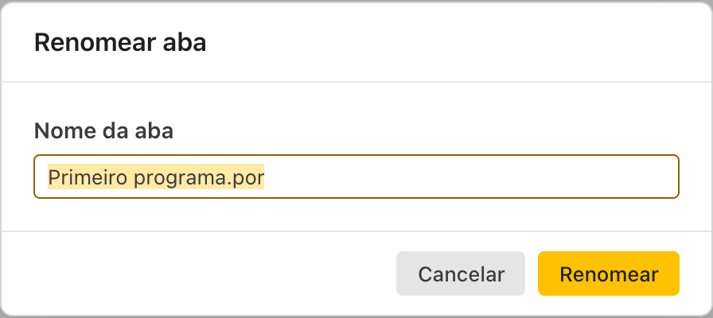
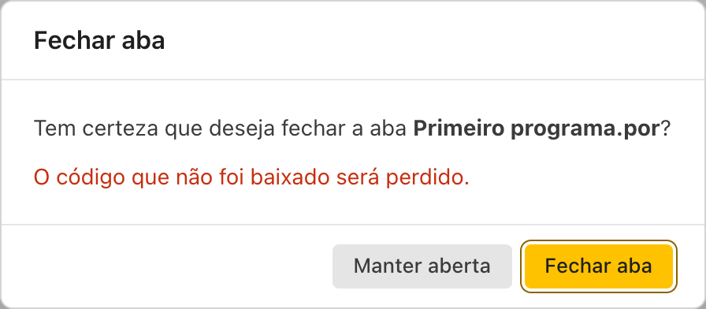
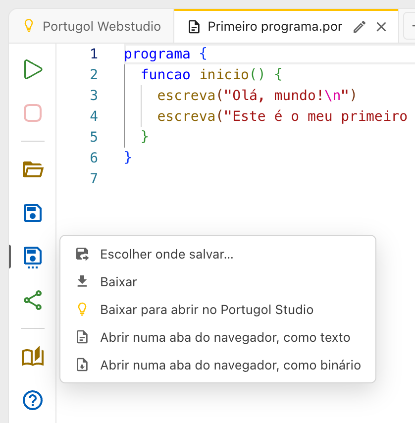

# Abas e arquivos

## Abas

Cada programa fica numa aba. A primeira aba, **Portugol Webstudio**, é a aba inicial, e ao lado dela ficam as abas de código, a Ajuda e o histórico de atualizações.

- **Nova aba**: clique no **+** ao lado da última aba, ou aperte **Alt + N**. A aba nova se chama "Sem título" e já vem com o modelo do programa.
- **Trocar de aba**: clique na aba, ou, com uma aba selecionada, use as **setas para a esquerda e para a direita**.
- **Renomear**: clique no lápis da aba, dê um duplo clique nela ou aperte **F2** com a aba selecionada. O nome da aba é o nome do arquivo ao salvar.
- **Fechar**: clique no **X** da aba, clique nela com o botão do meio do mouse, aperte **Delete** com a aba selecionada ou **Alt + W** em qualquer lugar.

Ao fechar uma aba com código, o Portugol Webstudio pergunta antes, porque o código que não foi baixado se perde. Abas vazias, ou só com o modelo inicial, fecham direto. A pergunta pode ser desligada nas [configurações](configuracoes.md).

Trocar de aba não interrompe um programa que está executando.

## O código fica guardado no navegador

Enquanto você escreve, o código de todas as abas fica guardado no navegador. Se você recarregar a página, ou fechar e abrir de novo, as abas voltam como estavam, e o Portugol Webstudio avisa: "Recuperamos o código que você estava editando."

Ao abrir o Portugol Webstudio numa janela nova, ela começa com as abas da última janela fechada. Se preferir começar com a janela vazia, desligue **Reabrir as abas da última janela** nas [configurações](configuracoes.md). Nesse caso, o código fica na aba inicial, em **Código de sessões anteriores**, com os botões **Restaurar** e **Descartar**.

O código de sessões anteriores fica guardado por até 30 dias. Quando passa de 10 sessões, as mais antigas são apagadas.

> O código fica só neste navegador, neste computador. Para levar o programa para outro lugar, baixe o arquivo ou [compartilhe o código](compartilhando.md). Se o navegador não puder guardar o código, como numa janela anônima, o Portugol Webstudio avisa, e é preciso baixar o arquivo antes de fechar a aba.

## Abrindo arquivos

Clique em **Abrir arquivo**, na aba inicial ou na barra de ações, ou aperte **Ctrl + O**. Dá para escolher vários arquivos `.por` de uma vez, e cada um abre numa aba nova.

Os arquivos salvos pelo Portugol Studio abrem com os acentos certos.

Com o Portugol Webstudio instalado como aplicativo, também dá para abrir um arquivo `.por` direto do computador, com um duplo clique (veja [Sem internet e atualizações](sem_internet.md)).

## Salvando

Clique em **Salvar**, na barra de ações, ou aperte **Ctrl + S**: o código vai para a pasta de downloads como um arquivo `.por`, com o nome da aba.

O botão **Salvar como…**, logo abaixo, mostra outras opções:

- **Escolher onde salvar…**: pergunta a pasta e o nome do arquivo. Só aparece nos navegadores que permitem isso, como o Chrome e o Edge no computador.
- **Baixar**: o mesmo que o botão Salvar.
- **Baixar para abrir no Portugol Studio**: salva o arquivo na codificação que o Portugol Studio usa, para que os acentos apareçam certos nele. Caracteres que o Portugol Studio não consegue mostrar, como emojis, viram `?`.
- **Abrir numa aba do navegador, como texto** e **como binário**: abrem o código numa aba nova do navegador, de onde dá para copiar ou salvar.
