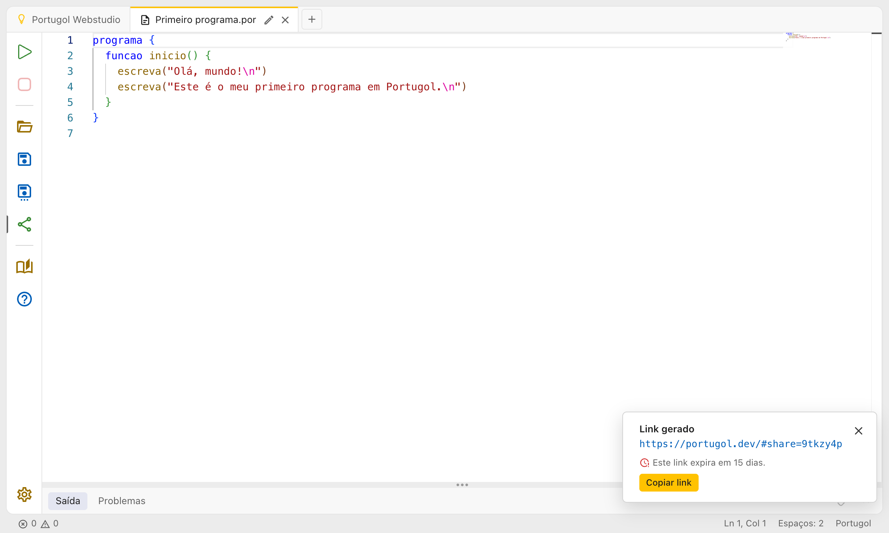

# Compartilhando código

Para mandar um programa para outra pessoa, como um colega ou o professor, clique em **Compartilhar código** na barra de ações.

O Portugol Webstudio gera um link e mostra uma mensagem com ele e o botão **Copiar link**. Cole o link onde quiser, como numa conversa ou num e-mail.

Quem abrir o link vê o Portugol Webstudio com o código numa aba nova, chamada "Código compartilhado". Essa pessoa recebe uma cópia: o que ela mudar não muda o seu código.

> O link expira em 90 dias. Para guardar o código por mais tempo, baixe o arquivo (veja [Abas e arquivos](abas_e_arquivos.md)).

O código é enviado para a internet ao gerar o link, e qualquer pessoa com o link pode vê-lo. Não compartilhe informações pessoais no código.
