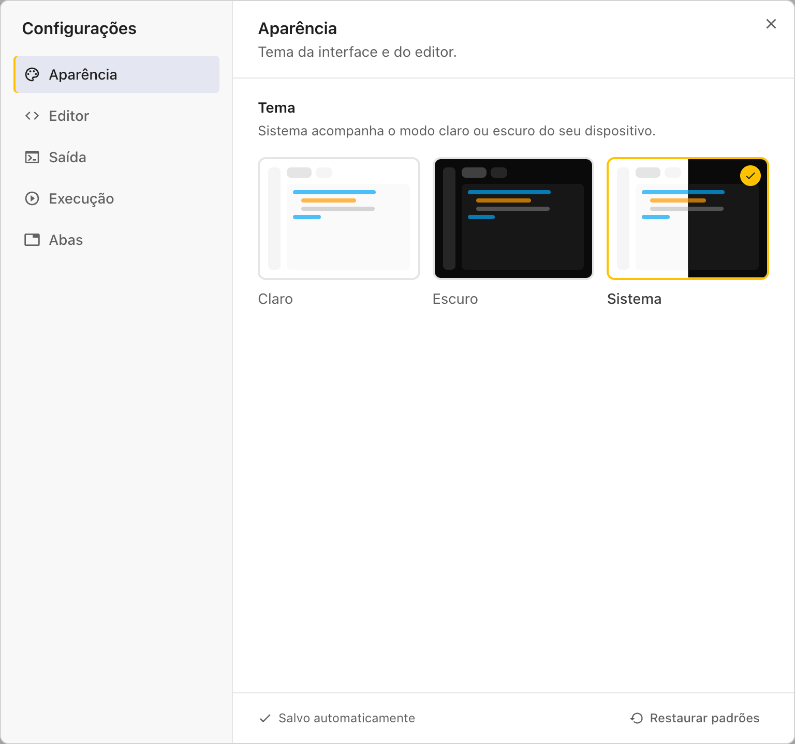
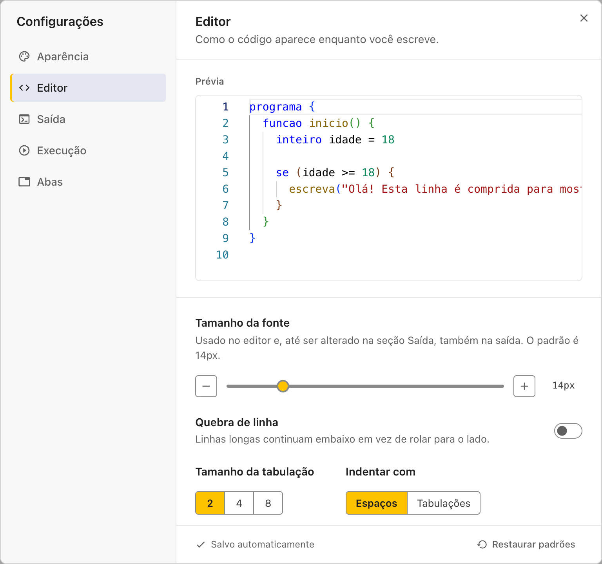
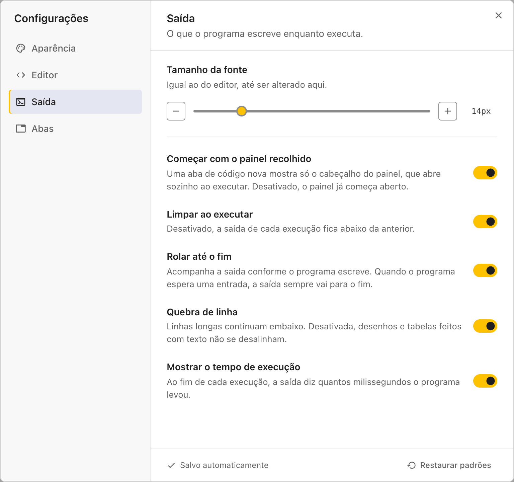
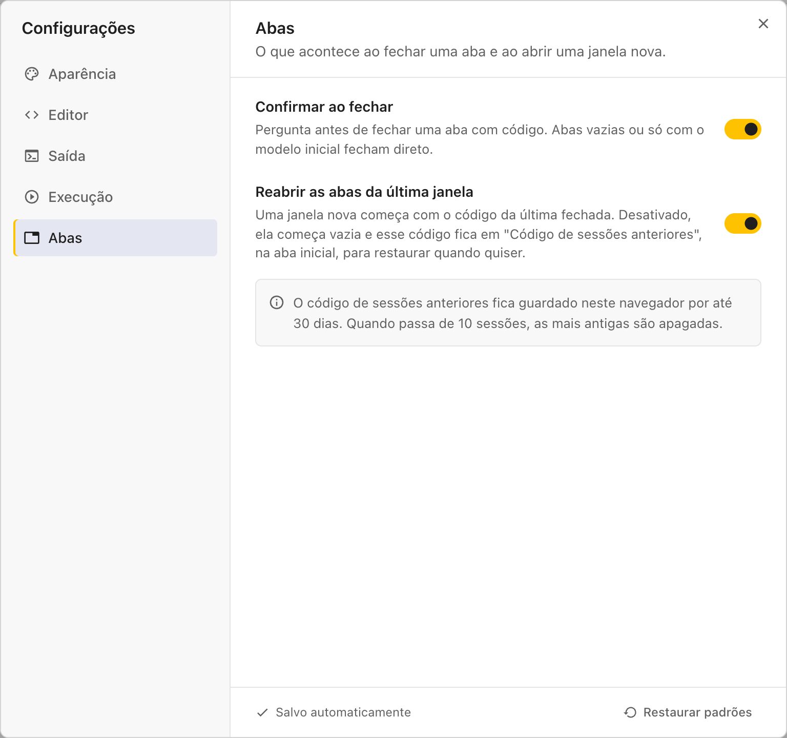

# Configurações

Para abrir as configurações, clique na engrenagem no pé da barra de ações, ou em **Configurações** na aba inicial. Elas são divididas em quatro seções: **Aparência**, **Editor**, **Saída** e **Abas**.

As mudanças valem na hora e ficam salvas no navegador. Para voltar ao jeito original, clique em **Restaurar padrões**.

## Aparência

| Configuração | Opções                             | Padrão  |
| ------------ | ---------------------------------- | ------- |
| Tema         | **Claro**, **Escuro**, **Sistema** | Sistema |

Com **Sistema**, o tema acompanha o modo claro ou escuro do seu computador ou celular.

## Editor

Como o código aparece enquanto você escreve. A **Prévia**, no alto, mostra cada mudança na hora.

| Configuração                          | O que faz                                                                                     | Padrão             |
| ------------------------------------- | --------------------------------------------------------------------------------------------- | ------------------ |
| Tamanho da fonte                      | O tamanho das letras no editor e, até ser alterado na seção Saída, também na saída            | 14px (12px no Mac) |
| Quebra de linha                       | Linhas longas continuam embaixo em vez de rolar para o lado                                   | Desligada          |
| Tamanho da tabulação                  | Quantos espaços vale cada nível de indentação                                                 | 2                  |
| Indentar com                          | **Espaços** ou **Tabulações**                                                                 | Espaços            |
| Números das linhas                    | **Exibir**, **Relativos** (contados a partir da linha do cursor) ou **Ocultar**               | Exibir             |
| Destacar a linha atual                | Uma faixa marca a linha do cursor: **Nunca**, **No código** ou **No código e na margem**      | No código          |
| Exibir espaços em branco              | Espaços aparecem como pontos e tabulações como setas: **Nunca**, **Na seleção** ou **Sempre** | Na seleção         |
| Estilo do cursor                      | **Linha**, **Bloco** ou **Sublinhado**                                                        | Linha              |
| Sugestões ao digitar                  | A lista de palavras enquanto você escreve. Desligada, ainda abre com **Ctrl + Espaço**        | Ligada             |
| Mostrar erros enquanto digita         | Desligada, os erros só são marcados no código ao executar                                     | Ligada             |
| Fechar chaves e aspas automaticamente | Ao abrir chaves, parênteses ou aspas, o fechamento já aparece                                 | Ligada             |
| Minimapa                              | A miniatura do código ao lado da barra de rolagem. No celular, fica sempre escondida          | Ligada             |
| Guias de indentação                   | Linhas verticais ligando o início e o fim de cada bloco                                       | Ligada             |
| Colorir pares de chaves e parênteses  | Cada nível de chaves e parênteses ganha uma cor                                               | Ligada             |
| Recolher blocos                       | Setas na margem escondem e mostram o conteúdo de cada bloco                                   | Ligada             |
| Fixar o bloco atual no topo           | Ao rolar, a linha de início da função e dos blocos em que o cursor está fica visível no alto  | Ligada             |

## Saída

O que o programa escreve enquanto executa.

| Configuração                   | O que faz                                                                                                          | Padrão            |
| ------------------------------ | ------------------------------------------------------------------------------------------------------------------ | ----------------- |
| Tamanho da fonte               | O tamanho das letras na saída. O botão **Usar o tamanho do editor** volta a acompanhar o editor                    | O mesmo do editor |
| Começar com o painel recolhido | Uma aba de código nova mostra só o cabeçalho do painel, que abre sozinho ao executar                               | Ligada            |
| Limpar ao executar             | Desligada, a saída de cada execução fica abaixo da anterior                                                        | Ligada            |
| Rolar até o fim                | Acompanha a saída conforme o programa escreve. Quando o programa espera uma entrada, a saída sempre vai para o fim | Ligada            |
| Quebra de linha                | Linhas longas continuam embaixo. Desligada, desenhos e tabelas feitos com texto não se desalinham                  | Ligada            |
| Mostrar o tempo de execução    | Ao fim de cada execução, a saída diz quantos milissegundos o programa levou                                        | Ligada            |

## Abas

O que acontece ao fechar uma aba e ao abrir uma janela nova.

| Configuração                     | O que faz                                                                                                                                               | Padrão |
| -------------------------------- | ------------------------------------------------------------------------------------------------------------------------------------------------------- | ------ |
| Confirmar ao fechar              | Pergunta antes de fechar uma aba com código. Abas vazias ou só com o modelo inicial fecham direto                                                       | Ligada |
| Reabrir as abas da última janela | Uma janela nova começa com o código da última fechada. Desligada, ela começa vazia, e o código fica em **Código de sessões anteriores**, na aba inicial | Ligada |

Veja mais sobre as abas e o código guardado no navegador em [Abas e arquivos](abas_e_arquivos.md).
