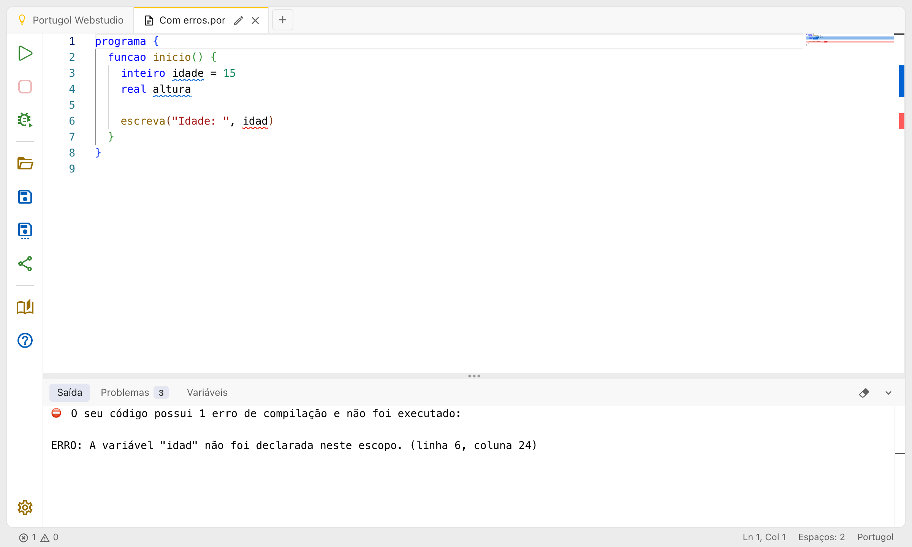
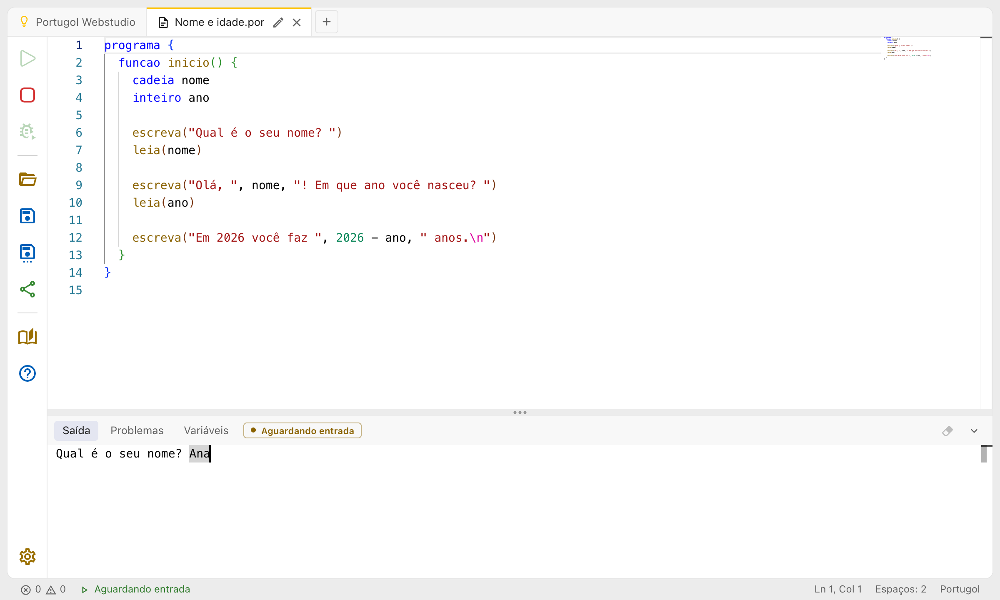
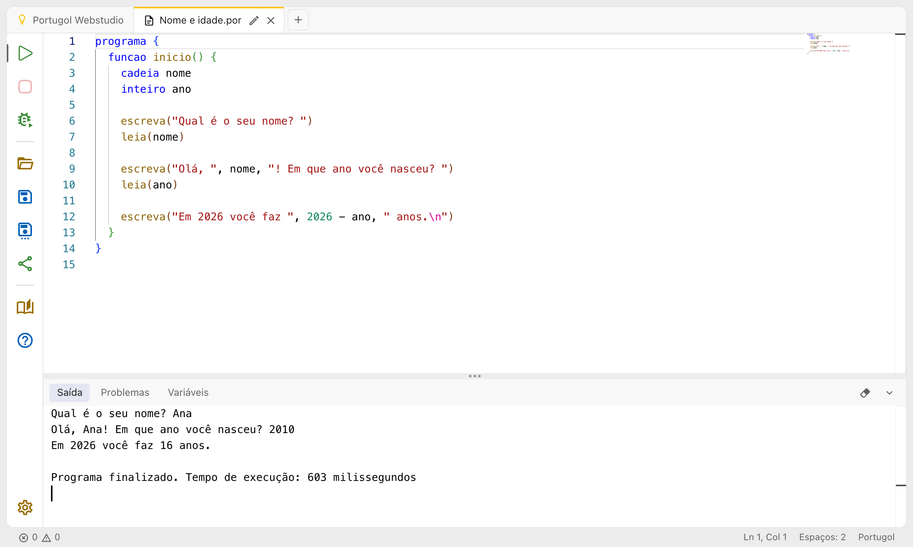
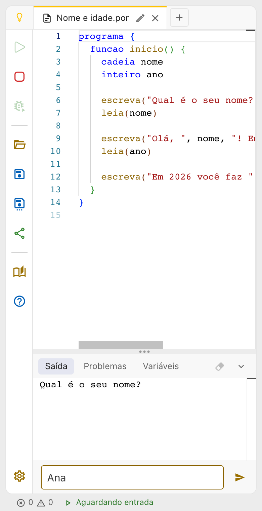

# Executando programas

## Executar e parar

Para executar o programa da aba aberta, clique no botão verde **Executar**, no alto da barra de ações, ou aperte **Ctrl + Enter**. Enquanto o programa executa, o botão vermelho **Parar** (ou **Shift + F5**) fica disponível para interrompê-lo, o que é útil num laço que nunca termina.

O painel de baixo abre sozinho na aba **Saída**, com tudo o que o programa escreveu. Quando ele termina, a saída diz:

- **Programa finalizado**, quando o programa chegou ao fim
- **O programa foi interrompido!**, quando você clicou em Parar

Depois vem o tempo de execução, em milissegundos. Ele pode ser escondido nas [configurações](configuracoes.md).

Para ver o programa executando um comando de cada vez, com o valor das variáveis, use o botão **Depurar**: veja [Executando passo a passo](depurando.md).

## Programas com erro

Um programa com erro não é executado. Ao clicar em Executar, o painel abre na aba **Problemas**, com a lista dos erros: clique num deles para ir até ele no código (veja [O editor de código](editor.md)). A aba **Saída** também diz quantos erros foram encontrados e lista cada um, com a linha e a coluna.

Um erro que só acontece durante a execução, como uma divisão por zero ou uma posição de vetor que não existe, interrompe o programa e aparece na saída com o símbolo ⛔, a mesma mensagem do Portugol Studio e a linha e a coluna do comando em que aconteceu. Essa linha também fica marcada de vermelho no código, até o código mudar ou o programa executar de novo.

## Entrada de dados com o leia

Quando o programa chega num `leia`, ele espera a pessoa digitar um valor, e o painel e a barra de status mostram **Aguardando entrada**.

No computador, digite a resposta direto na saída e aperte **Enter**. O Backspace apaga o que foi digitado.

Depois de cada Enter, o programa continua até o próximo `leia` ou até o fim. Um valor de outro tipo, como uma palavra num `leia` de um `inteiro`, ou nenhum valor, fora de uma `cadeia`, interrompe o programa com um erro.

No celular e no tablet, o teclado da tela não consegue digitar direto na saída. Por isso aparece um campo de texto embaixo dela, com o botão **Enviar entrada**: digite a resposta e aperte Enter ou o botão.

## O painel de baixo

O painel tem três abas, **Saída**, **Problemas** e **Variáveis** (veja [Executando passo a passo](depurando.md)), e alguns botões à direita:

- **Limpar saída** apaga o que está na saída.
- **Recolher painel** e **Mostrar painel** escondem e mostram o conteúdo do painel.

Arraste a divisória entre o editor e o painel para mudar a altura dele. O Portugol Webstudio lembra a altura escolhida.

Por padrão, uma aba de código nova começa com o painel recolhido, e ele abre sozinho ao executar. A saída também é limpa a cada execução e acompanha o programa até o fim conforme ele escreve. Tudo isso pode ser mudado nas [configurações](configuracoes.md), na seção **Saída**.

## Gráficos

Um programa que usa a biblioteca Graficos abre uma janela com o desenho por cima do editor. A janela pode ser arrastada para qualquer lugar da tela. Fechar a janela, pelo botão **Fechar janela** ou com **Esc**, também para o programa. Quando o programa termina, a janela fecha sozinha. No modo tela cheia, a janela ocupa a aba toda do navegador.

As bibliotecas disponíveis estão em [Bibliotecas](../linguagem_portugol/bibliotecas/index.md).
