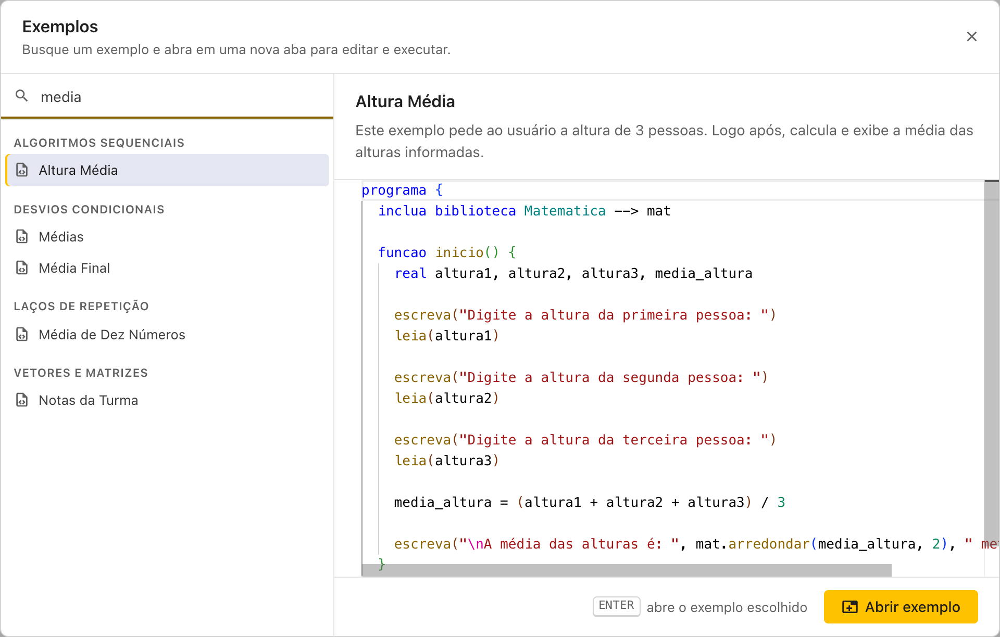
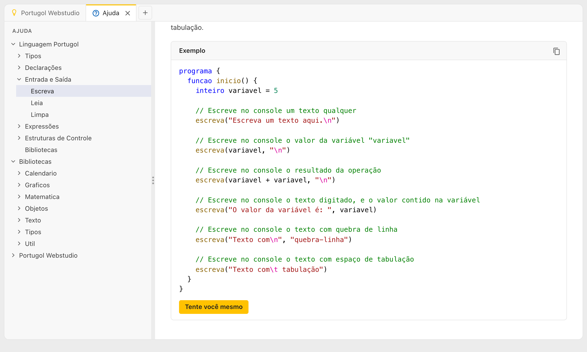

# Exemplos

O Portugol Webstudio vem com programas prontos para estudar, executar e modificar, de um simples "Olá, mundo" até jogos.

## Abrindo um exemplo

Clique em **Abrir exemplo**, na aba inicial ou na barra de ações. Os exemplos ficam agrupados por assunto: Entrada e Saída, Operações Aritméticas, Desvios Condicionais, Laços de Repetição, Vetores e Matrizes, Bibliotecas, Jogos e outros.

- **Buscar**: digite no campo de busca. A busca procura no nome, no assunto e na descrição de cada exemplo, e não diferencia acentos nem letras maiúsculas: "media" encontra "Média".
- **Escolher**: clique num exemplo, ou use as **setas para cima e para baixo**. Ao lado, aparecem a descrição e o código dele.
- **Abrir**: aperte **Enter**, dê um duplo clique no exemplo ou clique em **Abrir exemplo**. O exemplo abre numa aba nova, com o nome dele, pronto para executar.

No celular, a lista não tem a prévia, e um toque no exemplo já o abre.

O exemplo aberto é uma cópia: mude o que quiser, porque o original continua na lista.

## Exemplos na Ajuda

As páginas da Ajuda também têm exemplos. Abaixo de cada um, o botão **Tente você mesmo** abre o código numa aba nova, e o botão **Copiar código** copia o código para colar onde quiser.

