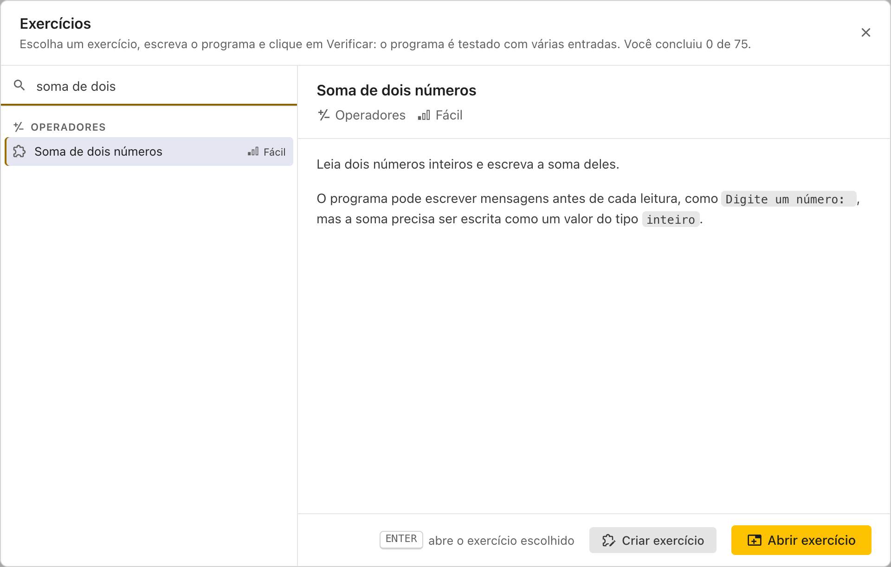
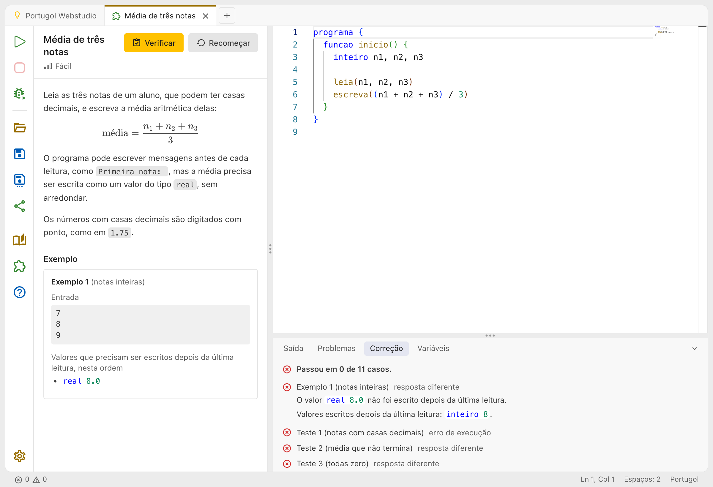

# Exercícios

Nos exercícios, você escreve um programa para um enunciado, e o Portugol Webstudio testa o programa com várias entradas: na hora, você fica sabendo se ele está certo. Os exercícios vão de **Saída** até **Funções**, em três níveis de dificuldade.

## Escolhendo um exercício

Clique em **Exercícios**, na aba inicial ou na barra de ações. Os exercícios ficam agrupados por assunto, na ordem de um curso, cada um com a dificuldade: fácil, médio ou difícil. Os que você já concluiu ganham um ✓, e o topo da janela mostra quantos você já concluiu.

- **Buscar**: digite no campo de busca. A busca procura no nome, no assunto e na dificuldade, e não diferencia acentos nem letras maiúsculas: "media" encontra "Média".
- **Escolher**: clique num exercício, ou use as **setas para cima e para baixo**. Ao lado, aparece o enunciado dele.
- **Abrir**: aperte **Enter**, dê um duplo clique no exercício ou clique em **Abrir exercício**.

No celular, a lista não tem a prévia, e um toque no exercício já o abre.

## A aba do exercício

O exercício abre numa aba própria, com o enunciado ao lado do código (no celular, em cima). O enunciado diz o que o programa recebe e o que ele escreve, e os **exemplos** mostram entradas e respostas esperadas.

Cada exercício tem uma aba só: abrir o mesmo exercício de novo leva até ela. O nome da aba é o do exercício, e não pode ser trocado.

- **Executar** funciona como numa aba de código comum: você digita as entradas e vê a saída.
- **Verificar**, no alto do enunciado, testa o programa com os exemplos e com outros casos, os testes, que ficam escondidos. O atalho é **Ctrl + Shift + Enter**. Enquanto ele confere, o mesmo botão vira **Parar**.

## A aba Correção

O resultado aparece na aba **Correção**, no painel de baixo, com o resumo ("Passou em 3 de 10 casos.") e cada caso, um por linha.

- **Nos exemplos**, a Correção mostra o que era esperado e o que o programa fez. No modo que compara o texto, ela mostra a linha diferente e a saída inteira do programa.
- **Nos testes escondidos**, ela mostra só se passou e o tipo da falha, com a descrição do teste, como "Teste 4 (números negativos) resposta diferente". A descrição diz onde procurar, sem dar a resposta.

As falhas dizem o que aconteceu:

| Falha                                         | O que aconteceu                                                                                                            |
| --------------------------------------------- | -------------------------------------------------------------------------------------------------------------------------- |
| resposta diferente                            | O programa escreveu outra coisa                                                                                            |
| tempo esgotado (60 segundos)                  | O programa não terminou em 60 segundos, como num laço que não acaba. Os casos seguintes não são testados                   |
| pediu mais entradas do que o caso tem         | O programa tem mais `leia` do que as entradas do caso                                                                      |
| sobraram 2 entradas sem ser lidas             | O programa leu menos entradas do que o caso tem                                                                            |
| erro de execução                              | O programa parou com um erro, como uma posição que não existe num vetor                                                    |
| a função `soma` não existe                    | O exercício pede uma função que o programa não tem, com esse nome                                                          |
| a função `soma` tem outra assinatura          | A função existe, mas com outros tipos nos parâmetros ou no retorno                                                         |
| a função `soma` retornou outro valor          | A função foi chamada com os argumentos do caso e retornou outra coisa                                                      |
| a função `soma` pediu uma entrada             | A função tem um `leia`: numa verificação de função, ela é chamada sozinha, sem entradas                                    |
| tempo esgotado na função `soma` (60 segundos) | A função não terminou em 60 segundos                                                                                       |
| erro de execução na função `soma`             | A função parou com um erro                                                                                                 |
| correção interrompida                         | A conferência foi parada no meio, com o **Parar**: esse caso aparece como "Não conferido", e os seguintes não são testados |

Com erros de compilação, o programa nem é testado: os erros ficam na aba **Problemas**. Algumas bibliotecas, como a Graficos e a Teclado, não fazem sentido num exercício e não são aceitas. Um programa que usa o `sorteia` ganha um aviso, porque o resultado pode mudar a cada execução.

## Como o programa é testado

O enunciado de cada exercício diz o que conta. Em geral, um exercício confere de um destes jeitos:

- **O texto escrito**: a saída do programa é comparada linha a linha com a esperada. Os espaços no começo e no fim de cada linha, e as linhas em branco no fim, não contam. Mensagens como "Digite um número:" fazem parte da saída: escreva só o que o enunciado pede. O que você digita no `leia` não entra na comparação.
- **Os valores escritos**: cada valor que o `escreva` escreve é conferido com o tipo. Para o exercício, `8`, `8.0` e `"8"` são valores diferentes: um `inteiro`, um `real` e uma `cadeia`. Um `real` vale com uma pequena diferença, como `0.1 + 0.2` no lugar de `0.3`. Quando o exercício diz que o programa precisa escrever certos valores, só conta o que for escrito depois da última leitura, nessa ordem, e os outros valores, como mensagens, não atrapalham.
- **Uma função**: o exercício chama uma função do seu programa, com os argumentos de cada caso, e confere o que ela retorna. A função `inicio` não é executada, e pode ficar vazia ou testar a função como você quiser.

## O seu progresso

O seu código e os exercícios concluídos ficam guardados neste navegador:

- O código é salvo a cada mudança. Fechando a aba e abrindo o exercício de novo, ele volta como estava.
- Um exercício concluído continua concluído, mesmo que um **Verificar** depois falhe. Quando o código muda depois de passar, o enunciado mostra "O código mudou desde que passou." e o link **Reverter alterações**, que traz de volta o código que passou.
- **Recomeçar**, ao lado do Verificar, volta ao código inicial do exercício, depois de confirmar. O exercício deixa de estar concluído.
- Se um exercício mudar numa atualização do Portugol Webstudio, o código que tinha passado é testado de novo ao abrir o exercício. Se não passar mais, o exercício deixa de estar concluído, e uma mensagem avisa.

> O progresso fica só neste navegador, neste computador, e se perde ao limpar os dados do navegador. Para levar o código para outro lugar, salve o arquivo ou compartilhe o código.

## Entregando ao professor

Salve o código (**Ctrl + S**) ou [compartilhe o código](compartilhando.md), como numa aba comum, e mande o arquivo ou o link pelo lugar que o professor pedir. O arquivo e o link levam a identificação do exercício num comentário no fim do código, como `/* @exercicio: pws:soma-de-dois-numeros */`.

Quem abre esse arquivo ou link, como o professor, vê o código numa cópia do exercício, com o enunciado e o **Verificar**. A cópia avisa "Aberto de um arquivo ou link: o Verificar não conta para o seu progresso.", e pode ser renomeada como uma aba comum. Dá para abrir as cópias de vários alunos ao mesmo tempo.

Para continuar num outro computador o código de um arquivo seu, abra o arquivo e clique em **Usar no meu exercício**, o botão com o ícone ao lado do **Verificar**, na cópia: depois de confirmar, o código da cópia passa a ser o seu código no exercício, e é testado em seguida.

## Exercícios do professor

O professor também pode [criar um exercício](criando_exercicios.md) e mandar um link. Ao abrir o link, o exercício aparece como os outros, e fica na lista de exercícios, em **Compartilhados com você**. Depois de aberto uma vez, ele funciona até sem internet.

O link vale até a data que o professor recebe ao compartilhar. Depois dela, o link não abre mais para quem ainda não o abriu; quem já abriu continua com o exercício na lista, em **Compartilhados com você**.

## Com um leitor de tela

O resultado do **Verificar** é anunciado, como "Passou em todos os 10 casos. Exercício concluído.". Na aba **Correção**, cada caso começa com "Passou", "Falhou" ou, numa conferência interrompida, "Não conferido", e o resultado nunca é mostrado só pela cor. Veja também [Acessibilidade](acessibilidade.md).
