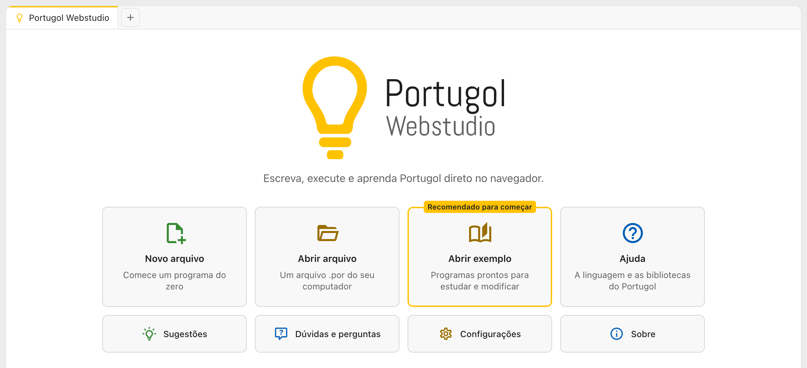

# Portugol Webstudio

O Portugol Webstudio é um ambiente para escrever, executar e aprender programação em Portugol direto no navegador. Não é preciso instalar nada: ele funciona no computador, no tablet e no celular, e depois da primeira visita funciona até sem internet.

Este guia mostra tudo o que dá para fazer no Portugol Webstudio:

- [Primeiros passos](primeiros_passos.md): o primeiro programa, do começo ao fim
- [O editor de código](editor.md): os botões, as cores, as sugestões e os erros
- [Executando programas](executando.md): a saída, a entrada de dados e os gráficos
- [Abas e arquivos](abas_e_arquivos.md): abrir, salvar e organizar o código
- [Exemplos](exemplos.md): programas prontos para estudar e modificar
- [Compartilhando código](compartilhando.md): mandar o código para outra pessoa por um link
- [Configurações](configuracoes.md): o tema, o editor, a saída e as abas
- [Atalhos de teclado](atalhos.md): tudo o que dá para fazer sem o mouse
- [Sem internet e atualizações](sem_internet.md): usar sem conexão e instalar como aplicativo
- [Acessibilidade](acessibilidade.md): teclado e leitores de tela
- [Diferenças em relação ao Portugol Studio](diferencas_portugol_studio.md): o que muda de um para o outro

Para aprender a linguagem em si, veja [Linguagem Portugol](../linguagem_portugol/index.md).
