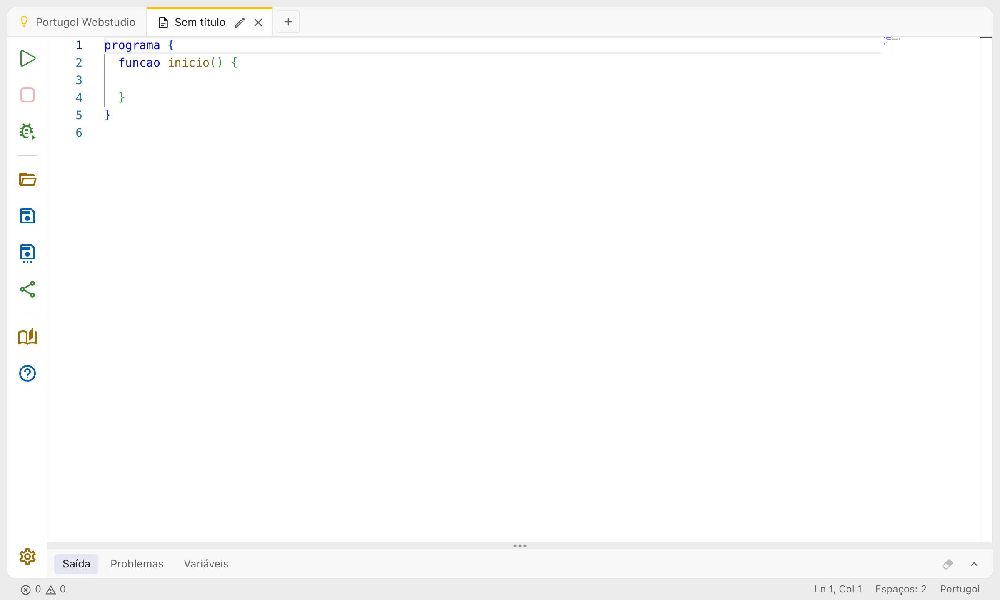

# Primeiros passos

Esta página mostra como escrever e executar o seu primeiro programa no Portugol Webstudio.

## A aba inicial

Ao abrir o Portugol Webstudio em [portugol.dev](https://portugol.dev), você vê a aba inicial. Dela você pode:

- Começar um programa do zero com **Novo arquivo**
- Abrir um arquivo `.por` do seu computador com **Abrir arquivo**
- Escolher um programa pronto com **Abrir exemplo**, o jeito mais fácil de começar
- Consultar a **Ajuda**, com a linguagem e as bibliotecas do Portugol


Mais abaixo, a aba inicial mostra as novidades da última atualização e, quando houver, o código que ficou aberto da última vez (veja [Abas e arquivos](abas_e_arquivos.md)).

## Criando um programa

Clique em **Novo arquivo**. Uma aba de código abre com o modelo de todo programa em Portugol: o bloco `programa` e, dentro dele, a função `inicio`, por onde o programa começa.



Escreva entre as chaves da função `inicio` o que o programa deve fazer. Por exemplo, para mostrar uma mensagem na tela:

```portugol exemplo title="Primeiro programa"
programa {
  funcao inicio() {
    escreva("Olá, mundo!\n")
    escreva("Este é o meu primeiro programa em Portugol.\n")
  }
}
```

O `\n` no fim do texto faz a próxima mensagem começar numa linha nova.

## Executando

Clique no botão verde **Executar**, no alto da barra à esquerda, ou aperte **Ctrl + Enter**. O painel de baixo abre na aba **Saída** e mostra o que o programa escreveu. Quando o programa termina, a saída diz "Programa finalizado" e quanto tempo ele levou.


## Lendo o que a pessoa digita

Com o comando `leia`, o programa espera a pessoa digitar um valor:

```portugol exemplo title="Nome e idade"
programa {
  funcao inicio() {
    cadeia nome
    inteiro ano

    escreva("Qual é o seu nome? ")
    leia(nome)

    escreva("Olá, ", nome, "! Em que ano você nasceu? ")
    leia(ano)

    escreva("Em 2026 você faz ", 2026 - ano, " anos.\n")
  }
}
```

Quando o programa chega num `leia`, o painel mostra **Aguardando entrada**. Digite a resposta direto na saída e aperte **Enter**. No celular e no tablet, aparece um campo de texto embaixo da saída (veja [Executando programas](executando.md)).


## Quando há um erro

Enquanto você escreve, o Portugol Webstudio confere o código. Um erro fica sublinhado em vermelho, e a aba **Problemas** lista todos eles, com a linha e a coluna. Clique num problema para ir até ele. Um programa com erro não é executado.


Veja mais em [O editor de código](editor.md).

## Salvando

O código das abas fica guardado no navegador enquanto você escreve: se você fechar a página e voltar, ele continua lá. Para ter o arquivo no seu computador, ou abrir no Portugol Studio, clique em **Salvar** ou aperte **Ctrl + S**. O arquivo `.por` vai para a pasta de downloads.

## Próximos passos

- Abra um [exemplo](exemplos.md) e modifique-o para ver o que acontece
- Aprenda a [linguagem Portugol](../linguagem_portugol/index.md): tipos, comandos e bibliotecas
- Nos exemplos da Ajuda, o botão **Tente você mesmo** abre o código numa aba nova, pronto para executar
