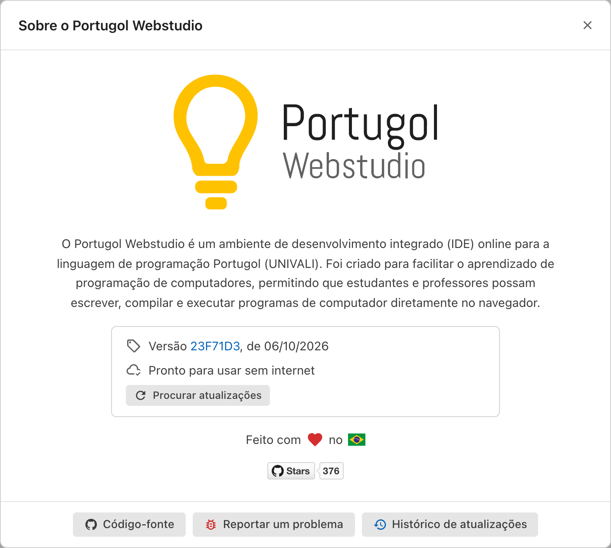

# Sem internet e atualizações

## Usando sem internet

Na primeira visita, o Portugol Webstudio se guarda no navegador. Quando termina, ele avisa: "O Portugol Webstudio já pode ser usado sem internet." A partir daí, ele abre e executa programas mesmo sem conexão, inclusive a Ajuda e os exemplos.

Só o que depende da internet não funciona sem ela, como [compartilhar código](compartilhando.md) e abrir um link compartilhado.

Para conferir, abra **Sobre**, na aba inicial. A janela mostra a versão e se o Portugol Webstudio está pronto para usar sem internet.

## Instalando como aplicativo

Nos navegadores que permitem, como o Chrome e o Edge, dá para instalar o Portugol Webstudio como um aplicativo, pelo botão de instalar na barra de endereço ou pelo menu do navegador. Instalado, ele:

- Abre numa janela própria, como os outros programas do computador
- Ganha atalhos para **Novo arquivo**, **Abrir exemplo** e **Ajuda**, ao clicar com o botão direito no ícone dele
- Abre arquivos `.por` direto do computador

## Atualizações

O Portugol Webstudio se atualiza sozinho. Quando uma versão nova é baixada, aparece a mensagem "Uma nova versão do Portugol Webstudio está disponível", com os botões **Atualizar** e **Ignorar**. O código das abas continua lá depois de atualizar.

Para procurar uma atualização na hora, abra **Sobre**, na aba inicial, e clique em **Procurar atualizações**.

As novidades de cada versão aparecem na aba inicial, em **Novidades**. Para ver todas, clique em **Ver o histórico de atualizações**.

## A versão beta

Na aba inicial, o link **Experimentar a versão beta**, no rodapé, abre a versão em que as novidades são testadas antes de chegarem a todos. O código guardado no navegador fica separado em cada versão: o que você escrever numa não aparece na outra.
