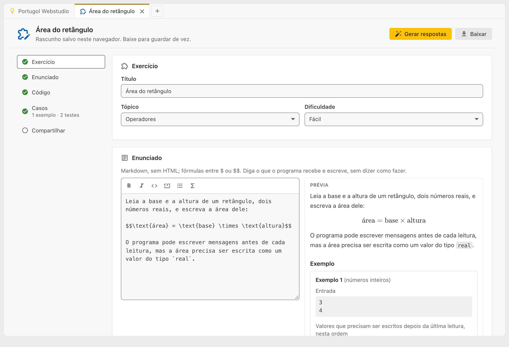
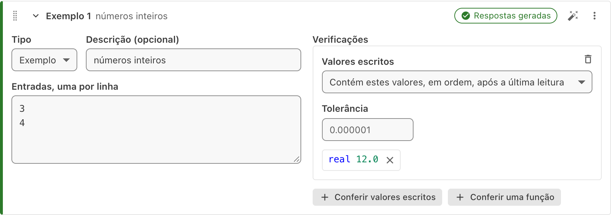

# Criando exercícios

Professores podem criar os próprios exercícios e mandar um link para os alunos. Os alunos resolvem como qualquer outro [exercício](exercicios.md), com o **Verificar** e a aba **Correção**.

As respostas esperadas nunca são digitadas: você escreve a solução, e o Portugol Webstudio a executa em cada caso para gerar as respostas.

## Começando

Na [lista de exercícios](exercicios.md), clique em **Criar exercício**. Abre uma aba de criação de exercício, chamada **Novo exercício** até o exercício ganhar um título, e dividida em etapas: **Exercício**, **Enunciado**, **Código**, **Casos** e **Compartilhar**. A lista das etapas, à esquerda (no alto, numa tela estreita), mostra o que já está pronto e leva até cada parte.



O rascunho fica guardado neste navegador enquanto a aba estiver aberta, como o código das outras abas. Para guardá-lo de vez, ou continuar em outro computador, use **Baixar**: o arquivo leva tudo, inclusive a solução, que nunca vai para o link (veja "Guardando o rascunho", mais abaixo).

## Exercício

Na etapa **Exercício**, preencha o **título**, o **tópico** e a **dificuldade** (fácil, médio ou difícil). O título e a dificuldade aparecem para os alunos na lista de exercícios e no alto do enunciado. Na lista, os exercícios recebidos por link ficam juntos, em **Compartilhados com você**, e não no tópico.

## Enunciado

O enunciado é escrito em Markdown: `**negrito**`, `_itálico_`, `` `código` ``, listas e blocos de código. A barra acima do campo tem botões para isso, e **Ctrl + B** e **Ctrl + I** também funcionam. Ao lado, a **Prévia** mostra o enunciado como o aluno vai ver.

- Fórmulas ficam entre `$`, como `$a + b$`, ou entre `$$`, numa linha só delas, para uma fórmula em destaque. Elas usam a notação do LaTeX, desenhada pelo [KaTeX](https://katex.org/): `$\frac{a}{b}$` é uma fração, `$x^2$` uma potência, `$\sqrt{x}$` uma raiz e `$a \le b$` um "menor ou igual". O guia [Fórmulas TeX](https://pt.wikipedia.org/wiki/Ajuda:Guia_de_edição/Fórmulas_TeX), da Wikipédia, mostra muitas outras, em português (lá, as fórmulas ficam entre `<math>` e `</math>`; aqui, entre `$`). A lista completa do que o KaTeX aceita, em inglês, está em [Supported Functions](https://katex.org/docs/supported).
- Código Portugol num bloco ` ```portugol ` aparece colorido, como no editor.
- HTML e imagens não são aceitos, e o enunciado tem limite de até 10.000 caracteres.

Diga o que o programa recebe e o que ele escreve, inclusive as mensagens, se elas contarem. Evite dizer como fazer.

## Código

- **Solução**: um programa que resolve o exercício. É dela que saem as respostas esperadas. A solução nunca vai para o link: fica só no rascunho e no arquivo baixado.
- **Código inicial** (opcional): o código com que o aluno começa. Sem mudanças, é o mesmo de uma aba nova.

Nos editores, o **Tab** escreve uma tabulação. Para ir ao próximo campo com o **Tab**, aperte antes **Ctrl + M** (no Mac, **Ctrl + Shift + M**).

## Casos

Cada caso é uma execução do programa do aluno. Os **exemplos** aparecem no enunciado, com as entradas e as respostas. Os **testes** ficam escondidos: o aluno só vê se passou, o tipo da falha e a descrição do teste. Um exercício precisa de pelo menos um exemplo e um teste.

Em cada caso:

- **Entradas, uma por linha**: o que o programa recebe nos `leia`, na ordem, como se fosse digitado.
- **Descrição** (opcional): aparece na Correção, como "Teste 3 (números negativos)". Descreva a situação, sem a resposta.



Em **Como conferir**, que vale para todos os casos, escolha como as respostas são comparadas:

- **Texto escrito**: a saída do programa é comparada linha a linha com a da solução. É o mais simples, mas as mensagens da solução, como "Digite um número:", precisam ser escritas igualzinho pelo aluno.
- **Valores e funções**: cada caso tem uma ou mais verificações.
  - **Conferir valores escritos**: os valores que a solução escreve, com o tipo (`inteiro 8` é diferente de `real 8.0`). Com **Contém estes valores, em ordem, após a última leitura**, as mensagens e outros valores do aluno não atrapalham, e dá para tirar da lista um valor que não deve contar, com o **X** ao lado dele. Com **São exatamente estes valores**, o aluno precisa escrever esses valores e mais nenhum. Com valores do tipo `real`, a **tolerância** diz a diferença aceita.
  - **Conferir uma função**: o nome de uma função da solução e os **argumentos, como numa chamada**, como `3, 2.5, "texto", {1, 2, 3}`. O exercício chama a função do aluno com esses argumentos e confere o retorno. Num caso só com funções, o `inicio` não é executado, então o caso não pode ter entradas.

O menu de cada caso tem **Subir**, **Descer** e **Remover**, e **Recolher todos** deixa só o resumo de cada caso.

Bons testes cobrem os valores pequenos e grandes, negativos e o zero, os empates e os limites que o enunciado dá, e os erros que um aluno cometeria.

## Gerando as respostas

Clique em **Gerar respostas**, no alto da aba: a solução é executada em cada caso e preenche a saída esperada, os valores escritos e os retornos. O botão com a varinha, em cada caso (**Gerar as respostas do Exemplo 1**, por exemplo), gera só as respostas dele.

Se a solução falhar num caso, como um erro, um tempo esgotado ou entradas que sobram, o problema aparece no caso, e o exercício não pode ser compartilhado até ser resolvido. Quando o caso, a solução ou o jeito de conferir muda depois, o caso fica marcado como **Desatualizado**: gere as respostas de novo.

## Compartilhando

Clique em **Compartilhar**, na última etapa. Antes, o Portugol Webstudio confere tudo, como faz com os exercícios que vêm com ele: o formato, se a solução passa nos próprios casos, se o código inicial compila e se as bibliotecas usadas valem num exercício. A lista acima do botão mostra o que já está pronto e o que ainda falta, e o que impedir o compartilhamento aparece logo abaixo do botão.

Depois, aparece o link do exercício, com o botão **Copiar**, e até quando ele funciona: 180 dias, cerca de um semestre.

O link guarda o exercício como ele estava. Mudando o exercício, o link mostrado some: compartilhe de novo para criar um link novo. O link antigo continua com a versão antiga.

> O exercício é enviado para a internet ao compartilhar, sem a solução, e qualquer pessoa com o link pode abri-lo.

## Guardando o rascunho

**Baixar**, no alto da aba, salva o rascunho inteiro, com a solução, num arquivo `.exercicio.json` com o nome do exercício. Para continuar depois, ou num outro computador, abra o arquivo com **Abrir arquivo**: ele volta numa aba de criação de exercício.

Ao fechar uma aba de criação com algo preenchido, o Portugol Webstudio pergunta antes (se a confirmação estiver ligada nas [configurações](configuracoes.md)), porque o rascunho que não foi baixado se perde.

## Recebendo as respostas dos alunos

Os alunos mandam o código como um arquivo ou um link (veja "Entregando ao professor", em [Exercícios](exercicios.md)). Abrindo o arquivo ou o link, você vê o código numa cópia do exercício, com o enunciado, e pode usar o **Verificar** sem mexer em nada. Dá para abrir as cópias de vários alunos ao mesmo tempo.

> Abra o link do exercício uma vez neste navegador: assim ele continua aqui, e você consegue conferir as respostas mesmo depois que o link expirar.
