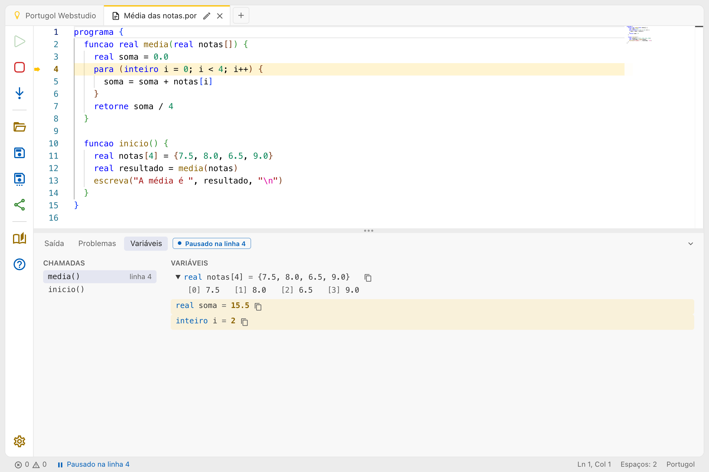
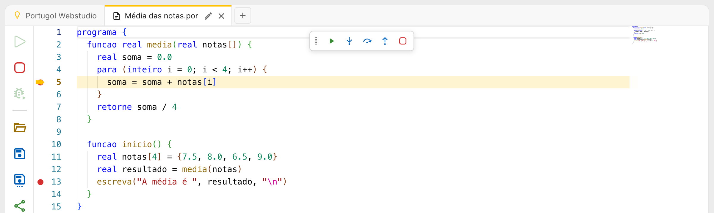

# Executando passo a passo

Executar o programa passo a passo, um comando de cada vez, mostra o caminho que ele faz e o valor de cada variável a cada momento. É o jeito mais fácil de entender um programa, e de achar o motivo de um resultado errado.

## Começar

Clique no botão **Depurar**, logo abaixo do **Parar** na barra de ações, ou aperte **Alt + P**. O programa começa e para antes do primeiro comando da função `inicio`:

- A linha que vai ser executada fica destacada no código, com uma seta ao lado do número dela.
- O painel de baixo abre na aba **Variáveis**.
- O código não pode ser editado durante a depuração. Para editar, clique em **Parar**.

## Avançar

Com o programa pausado, o botão **Depurar** vira o **Próximo passo**, no mesmo lugar, como no Portugol Studio. Ele executa o comando da linha destacada e para no próximo, e o atalho dele é **Alt + P**. Numa chamada de uma função do programa, ele entra na função e para no primeiro comando dela.

Nos laços `enquanto` e `para`, o programa para na linha do laço a cada vez que testa a condição. No `para`, o incremento já foi feito quando ele para ali.

Um `leia` funciona normalmente: o painel mostra a **Saída** para você digitar, e o programa para de novo no comando seguinte, com o painel de volta na aba **Variáveis**.

Para terminar antes do fim, clique em **Parar**.

## A aba Variáveis

Enquanto o programa está pausado, a aba **Variáveis** mostra:

- **Chamadas**: as funções em andamento, da que está executando, em cima, até a `inicio`. Clique numa delas para ver as variáveis dela.
- **Variáveis**: as variáveis já declaradas na função escolhida, cada uma como a linha que a declara, com o valor de agora, como `real soma = 15.5`. Uma variável que ainda não recebeu um valor aparece como _sem valor_.
- **Globais**: as variáveis declaradas fora das funções, quando houver.

O valor que mudou desde a última pausa fica destacado. Vetores e matrizes aparecem numa linha só, como `{1, 2, 3}`: clique no valor para ver cada posição, e as matrizes aparecem como uma tabela.

O botão **Copiar a declaração**, depois de cada valor, copia a linha inteira, com todos os valores de um vetor ou matriz, como `real notas[4] = {7.5, 8.0, 6.5, 9.0}`. Ela pode ser colada direto num programa.

## Depuração avançada

Ligando a **Depuração avançada**, na seção **Execução** das [configurações](configuracoes.md), a execução passo a passo ganha mais botões e os pontos de parada. Os botões ficam numa barra flutuante, no alto do código, e não na barra de ações. A barra pode ser arrastada pela alça à esquerda para qualquer lugar do editor, e o Webstudio lembra onde ela ficou. Dois cliques na alça, ou o Enter com o foco nela, a levam de volta ao lugar inicial, no alto do editor. Com o teclado, as setas andam entre os botões dela. O editor também ganha uma margem à esquerda dos números das linhas, com uma seta na linha em que o programa está pausado e os pontos de parada.

| Botão          | Atalho  | O que faz                                                                                   |
| -------------- | ------- | ------------------------------------------------------------------------------------------- |
| Continuar      | Alt + C | Executa normalmente, até o próximo ponto de parada ou até o fim do programa                 |
| Pausar         | Alt + C | Com o programa continuando, pausa onde ele estiver, o que é útil num laço que nunca termina |
| Próximo passo  | Alt + P | O mesmo da depuração simples: executa a linha destacada, entrando nas funções               |
| Pular função   | Alt + J | Como o Próximo passo, mas executa as funções chamadas na linha de uma vez, sem entrar nelas |
| Sair da função | Alt + R | Executa o resto da função em que o programa está e para logo depois, em quem a chamou       |
| Parar          |         | Interrompe o programa, como o Parar da barra de ações                                       |

### Pontos de parada

Num programa grande, ir passo a passo até o trecho que interessa demora. Marque um ponto de parada nesse trecho, clicando na margem à esquerda do número da linha, ou com o cursor na linha e o atalho **Alt + M**. Uma bolinha vermelha aparece na margem. Para desmarcar, clique na bolinha ou aperte **Alt + M** de novo. O programa só para numa linha que tenha um comando: numa linha em branco ou só com um `}`, ele passa direto.

Com pontos de parada marcados, o **Depurar** executa o programa normalmente e só para quando chega numa dessas linhas. Depois, o **Continuar** vai até a próxima vez em que o programa passar por um ponto de parada. Dá para marcar e desmarcar pontos de parada a qualquer momento, até com o programa executando, e eles continuam marcados para a próxima vez, até a página ser recarregada. Desligar a **Depuração avançada** desmarca todos eles.

## Com um leitor de tela

A cada pausa, o leitor de tela anuncia a linha, a função quando ela muda e o que mudou nas variáveis, como "Linha 12. total passou de 2 para 6". Na depuração avançada, marcar e desmarcar um ponto de parada também é anunciado.

## Terminar

O programa sai da depuração quando chega ao fim, quando acontece um erro ou quando você clica em **Parar**. O painel volta para a aba **Saída**, com o que o programa escreveu e o erro, se houver, e o leitor de tela anuncia o fim.
