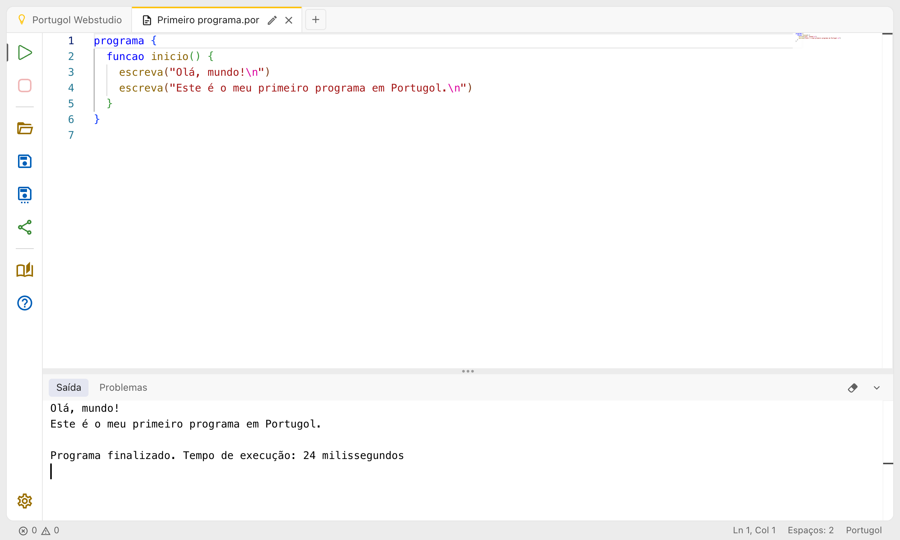
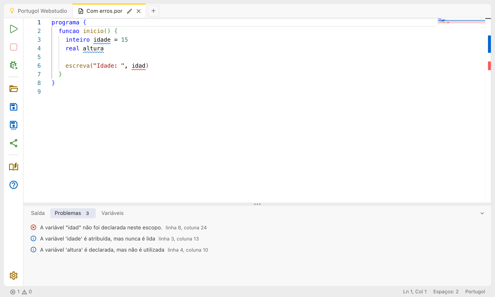
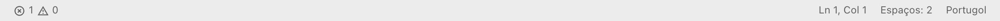

# O editor de código

Cada programa fica numa aba de código. Ela tem a barra de ações à esquerda, o editor no meio e, embaixo, o painel com a **Saída** e os **Problemas**.



## A barra de ações


De cima para baixo:

| Botão                   | O que faz                                                                    | Atalho       |
| ----------------------- | ---------------------------------------------------------------------------- | ------------ |
| **Executar**            | Executa o programa (veja [Executando programas](executando.md))              | Ctrl + Enter |
| **Parar**               | Interrompe o programa que está executando                                    |              |
| **Depurar**             | Executa passo a passo (veja [Executando passo a passo](depurando.md))        | Alt + P      |
| **Abrir arquivo**       | Abre arquivos `.por` do computador, cada um numa aba nova                    | Ctrl + O     |
| **Salvar**              | Baixa o código como um arquivo `.por`                                        | Ctrl + S     |
| **Salvar como…**        | Mostra outras formas de salvar (veja [Abas e arquivos](abas_e_arquivos.md))  |              |
| **Compartilhar código** | Gera um link para o código (veja [Compartilhando código](compartilhando.md)) |              |
| **Abrir exemplo**       | Abre a lista de [exemplos](exemplos.md)                                      |              |
| **Ajuda**               | Abre a Ajuda                                                                 | F1           |
| **Configurações**       | Abre as [configurações](configuracoes.md)                                    |              |

Passe o mouse sobre um botão, ou chegue nele pelo teclado, para ver o nome e o atalho.

## Escrevendo o código

O editor ajuda enquanto você escreve:

- **Cores**: palavras como `programa`, `se` e `inteiro`, textos, números e comentários ganham cores diferentes, o que ajuda a perceber uma aspa ou um comentário que ficou aberto.
- **Sugestões**: enquanto você digita, aparece uma lista com as palavras do programa e da linguagem. Escolha uma com as setas e aperte **Enter** ou **Tab**. Para abrir a lista a qualquer momento, aperte **Ctrl + Espaço**.
- **Fechamento automático**: ao abrir chaves, parênteses ou aspas, o fechamento já aparece.
- **Pares de chaves**: cada nível de chaves e parênteses ganha uma cor, e as linhas verticais ligam o começo e o fim de cada bloco.
- **Recolher blocos**: as setas na margem, ao lado dos números das linhas, escondem e mostram o conteúdo de uma função ou de um bloco. Também dá para criar um bloco recolhível com os comentários `// regiao` e `// fimregiao` (veja abaixo).
- **Bloco fixo no topo**: ao rolar um programa grande, a linha de início da função e dos blocos em que o cursor está fica visível no alto do editor.
- **Minimapa**: à direita, uma miniatura do código mostra onde você está no programa. No celular, ele fica escondido.

Todos esses recursos podem ser ligados e desligados nas [configurações](configuracoes.md).

### Blocos recolhíveis com comentários

Para recolher um trecho qualquer do programa, como a parte que lê os dados, marque o começo com `// regiao` e o fim com `// fimregiao`. Uma seta aparece na margem, ao lado do comentário de começo, e o texto depois de `regiao` fica visível com o trecho recolhido:

```portugol sintaxe title="Um trecho recolhível"
// regiao Leitura dos dados
escreva("Qual é o seu nome? ")
leia(nome)
escreva("Qual é a sua idade? ")
leia(idade)
// fimregiao
```

Também valem `// região`, `// fim regiao` e `// fim região`, e os `// region` e `// endregion` do Visual Studio Code.

## Erros, avisos e informações

O Portugol Webstudio confere o código meio segundo depois que você para de digitar. O que ele encontra aparece de três formas:

- **Sublinhado no código**: vermelho para erros, amarelo para avisos e azul para informações. Passe o mouse sobre o trecho sublinhado para ler a mensagem.
- **Na aba Problemas**, no painel de baixo: a lista de tudo o que foi encontrado, com os erros primeiro, cada um com a linha e a coluna. Clique num problema para levar o cursor até ele.
- **Na barra de status**, embaixo à esquerda: a quantidade de erros e de avisos. Clique nela para abrir a aba Problemas.



Um **erro** impede o programa de ser executado: ao clicar em Executar, o programa não começa, e o painel abre na aba Problemas. Um **aviso** aponta algo que provavelmente está errado, mas o programa executa assim mesmo. Uma **informação** é uma dica, como uma variável que foi declarada e nunca usada.

Se preferir que os erros só apareçam ao executar, desligue **Mostrar erros enquanto digita** nas [configurações](configuracoes.md).

As mensagens de erro seguem as do Portugol Studio, com algumas melhorias. Veja [Diferenças em relação ao Portugol Studio](diferencas_portugol_studio.md).

## A barra de status

A barra no rodapé mostra informações sobre a aba de código aberta:



- **Erros e avisos**: clique para abrir a aba Problemas.
- **Executando** ou **Aguardando entrada**: aparece enquanto o programa executa.
- **Ln e Col**: a linha e a coluna do cursor. Clique, ou aperte **Ctrl + G**, para ir até uma linha.
- **Espaços** ou **Tabulação**: como o código é indentado. Clique para mudar nas configurações.
- **Portugol**: a linguagem do editor.

## Outros recursos do editor

O editor é o mesmo do Visual Studio Code, e muitos dos atalhos dele também funcionam, como **Ctrl + F** para procurar, **Ctrl + H** para substituir, **Ctrl + /** para comentar e descomentar linhas e **Alt + seta para cima/baixo** para mover uma linha. Veja a lista em [Atalhos de teclado](atalhos.md).

### Para curiosos: o código gerado

Para executar, o Portugol Webstudio traduz o programa para JavaScript, a linguagem dos navegadores. Na borda direita do editor há uma divisória fina: arraste-a para a esquerda para ver o código JavaScript gerado. Ele é só para leitura.
